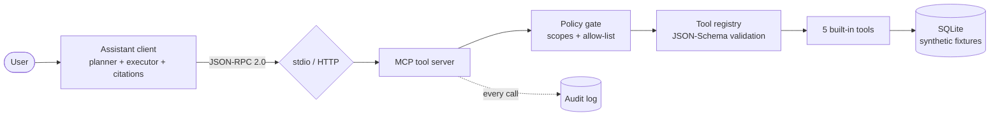

# MCP-Powered AI Assistant

An enterprise-grade reference implementation of an **MCP-style tool
server** and **assistant client**: tools exposed over JSON-RPC 2.0
(stdio *and* HTTP), a schema-validated tool registry, permission scopes
with an allow-list policy, a complete audit log, and a planning client
that chains tool calls and answers with citations.

All data is **synthetic** (invented orders, inventory, tickets, and
metrics) and all code is original — a clean-room build suitable for
studying the architecture without any real-world system behind it.

## The problem

Assistants that answer enterprise questions need three properties most
demos skip:

1. **Grounded answers** — facts come from tool results, never from the
   model's imagination, and each fact is cited.
2. **Least-privilege tool access** — a read-only analyst must not be
   able to mutate state, and enforcement belongs on the server.
3. **Reconstructability** — every tool call (allowed, denied, failed)
   is written to an audit log.

## Architecture



Full design notes, sequence diagrams, and trade-offs:
[docs/architecture.md](docs/architecture.md).

## The tools

| Tool | Scope | What it does |
|---|---|---|
| `order_lookup` | read | Order status, totals, and line items by ID or customer |
| `inventory_check` | read | Stock by SKU or product; available = on_hand − reserved; low-stock flag |
| `ticket_search` | read | Support-ticket search by text, status, priority |
| `metric_summary` | read | Revenue / orders / returns / AOV with totals and period-over-period change |
| `create_ticket` | **write** | Creates a support ticket — denied for read-only callers |

The server also serves **resources** (`enterprise://orders/recent`,
`enterprise://inventory/low-stock`,
`enterprise://metrics/latest-quarter`) and **prompt templates**
(`order_investigation`, `weekly_ops_review`).

## Quickstart

Requires Python 3.11+.

```bash
pip install -r requirements.txt
pip install -e .

# End-to-end demo (in-process): chains, citations, a denial, the audit log
python examples/demo_workflow.py
# equivalently: mcp-ai-assistant demo
```

Ask questions directly:

```bash
mcp-ai-assistant ask "What is the status of order ORD-1003 and do we have stock cover for its items?"
mcp-ai-assistant ask "Show me the open critical tickets"
mcp-ai-assistant ask "Give me a revenue summary for 2026-Q3"
```

Run the server:

```bash
# HTTP (FastAPI) — POST /rpc, GET /health, /tools, /audit
mcp-ai-assistant serve --transport http --port 8000

# stdio — line-delimited JSON-RPC, the classic local MCP transport
mcp-ai-assistant serve --transport stdio --read-only

# Raw stdio session against a spawned server process
python examples/stdio_session.py
```

Docker:

```bash
docker build -t mcp-ai-assistant .
docker run -p 8000:8000 mcp-ai-assistant
```

## Protocol examples

`tools/list` (request over either transport):

```json
{"jsonrpc": "2.0", "id": 1, "method": "tools/list", "params": {}}
```

`tools/call`:

```json
{"jsonrpc": "2.0", "id": 2, "method": "tools/call",
 "params": {"name": "order_lookup", "arguments": {"order_id": "ORD-1001"}}}
```

Response (abridged) — MCP-style dual payload, text + structured:

```json
{"jsonrpc": "2.0", "id": 2, "result": {
  "content": [{"type": "text", "text": "{...}"}],
  "structuredContent": {"found": true, "orders": [{"id": "ORD-1001", "status": "delivered", "...": "..."}]},
  "isError": false}}
```

A denied write (read-only caller) — and yes, the denial is audited:

```json
{"jsonrpc": "2.0", "id": 3, "error": {
  "code": -32003,
  "message": "Permission denied for tool 'create_ticket': requires 'write' scope; caller holds ['read']"}}
```

More HTTP examples: [examples/http_requests.md](examples/http_requests.md).

## How the assistant plans

- **`RuleBasedPlanner`** (default): deterministic, offline, regex-driven.
  Recognizes order IDs, SKUs, periods, regions, and intents — including
  the multi-step chain *"order status + stock cover"* → `order_lookup`
  fanned out into one `inventory_check` per line-item SKU.
- **`LLMPlanner`**: wraps any `str -> str` completion callable, asks for
  a JSON plan, validates it against the discovered catalog, and falls
  back to the rule planner on any failure. Bring your own model; the
  system never depends on one.

Answers are composed from structured results only, with citations like
`[order_lookup: ORD-1003]` and `[inventory_check: SKU-2003]`.

## Testing

```bash
pytest -q
```

The suite covers the protocol layer, registry/schema validation, every
built-in tool, policy enforcement (including audited denials), the
JSON-RPC dispatch, the HTTP transport, the stdio transport, and the
client's planning/chaining/citation behavior.

CI: [docs/github-actions-ci.yml](docs/github-actions-ci.yml) is a
ready-to-use GitHub Actions workflow (move it to
`.github/workflows/ci.yml` to activate).

## Limitations

- Synchronous, single-process server; no streaming or progress
  notifications yet.
- HTTP auth is a single static bearer token (`MCP_AI_API_TOKEN`) —
  production deployments should terminate OAuth/OIDC in front of it.
- Fixtures load into SQLite at startup; `create_ticket` writes are
  process-local unless a file-backed `db_path` is configured.
- The rule planner covers the built-in tools' domain; arbitrary
  questions need the LLM planner (BYO model) or return guidance text.
- Audit arguments are stored verbatim — add field-level redaction
  before pointing this at data with real PII.

## Roadmap

- OAuth 2.1 authorization server integration and per-caller policies
  from token claims.
- Progress notifications + cancellation for long-running tools.
- A tool SDK decorator (`@tool(schema=...)`) to cut registration
  boilerplate, and a Postgres-backed `DataStore`.
- Audit-log export to OpenTelemetry spans; a small audit-viewer UI.
- Sampling support so the server can request model completions through
  the client, per the full MCP specification.

## License

MIT — see [LICENSE](LICENSE).
