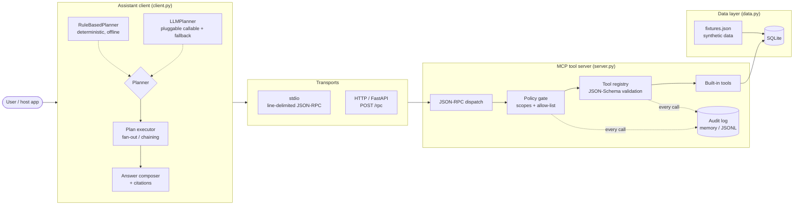
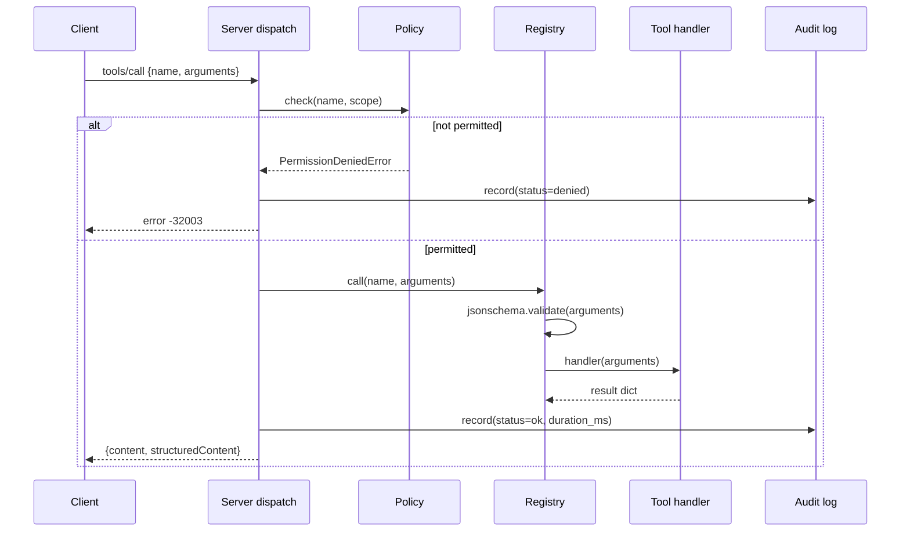

# Architecture — MCP-Powered AI Assistant

## Problem framing

Enterprise assistants fail in predictable ways: they hallucinate facts,
they reach for tools they should not have, and nobody can reconstruct
what they did afterwards. This project is a small but complete reference
architecture for doing it properly:

- **Facts come only from tools.** The assistant has no direct data
  access; every claim in an answer traces to a tool result, cited by
  record ID.
- **Tools are contracts.** Each tool publishes a JSON Schema; arguments
  are validated before business logic runs.
- **Least privilege by default.** Tools carry `read`/`write` scopes,
  callers hold scopes, and an optional allow-list narrows further.
  Enforcement happens twice — in the client (fail fast) and in the
  server (authoritative).
- **Everything is auditable.** Every `tools/call` — ok, denied, or
  errored — lands in an append-only audit log with caller, arguments,
  duration, and outcome.

## Components

### Protocol layer (`protocol.py`, `errors.py`)

JSON-RPC 2.0 messages with MCP method names and the MCP result shapes
(`tools/call` returns both human-readable `content` and machine-readable
`structuredContent`). Errors use standard JSON-RPC codes plus
application codes in the reserved server range (`-32001` tool not found,
`-32002` schema validation, `-32003` permission denied, …).

### Server (`server.py`)

`MCPServer.handle()` is transport-agnostic: it takes a decoded JSON
payload and returns a response dict (or `None` for notifications). That
single seam is what makes the stdio transport, the HTTP transport, and
the in-process test transport interchangeable. Method surface:

| Method | Purpose |
|---|---|
| `initialize` | Protocol version + capability negotiation |
| `ping` | Liveness |
| `tools/list` | Discover tools and their schemas/scopes |
| `tools/call` | Execute a tool (policy-checked, schema-validated, audited) |
| `resources/list`, `resources/read` | Read-only contextual documents (recent orders, low stock, latest metrics) |
| `prompts/list`, `prompts/get` | Reusable investigation/review prompt templates |

### Registry & tools (`registry.py`, `tools.py`)

The registry fails fast: schemas are checked with
`Draft202012Validator.check_schema` at registration time, and every call
is validated with `jsonschema.validate`. Built-in tools run over a
SQLite store loaded from synthetic JSON fixtures:

| Tool | Scope | Backing query |
|---|---|---|
| `order_lookup` | read | orders + line items by ID or customer |
| `inventory_check` | read | stock by SKU or product search, with availability math |
| `ticket_search` | read | ticket filters: text, status, priority |
| `metric_summary` | read | metric rows with totals and period-over-period deltas |
| `create_ticket` | write | inserts a ticket (the scope-enforcement demonstrator) |

### Client & planners (`client.py`)

A *transport* (`InProcessTransport`, `HTTPTransport`) hides where the
server lives. A *planner* turns text into `PlanStep`s:

- `RuleBasedPlanner` — regexes for order IDs, SKUs, periods, regions,
  statuses, and intents. Fully deterministic: same input, same plan.
  This is the offline guarantee.
- `LLMPlanner` — prompts any `str -> str` callable for a JSON plan,
  filters it against the discovered catalog, and silently falls back to
  the rule planner on malformed output, unknown tools, or exceptions.

Steps may declare `expand_from`, pointing at a list inside an earlier
step's result; the executor fans the step out into one call per element.
That powers the flagship chain: *order → its line items → one inventory
check per SKU*. Answers are composed from structured results only, and
each record referenced is collected into citations
(`[order_lookup: ORD-1003]`, `[inventory_check: SKU-2003, …]`).

### Policy & audit (`policy.py`, `audit.py`)

`ToolPolicy` holds granted scopes and an optional allow-list; `check()`
raises `PermissionDeniedError` before a handler runs. The server's
policy is authoritative — a client that skips its own check still
cannot exceed the server's grants, and the denial itself is audited.
Audit entries carry timestamp, caller, tool, scope, arguments, status
(`ok`/`denied`/`error`), duration, and a result summary; an optional
JSONL sink makes them durable and greppable.

## Request lifecycle (one `tools/call`)

## Design trade-offs

- **In-process transport exists** so tests and demos exercise the exact
  dispatch path with zero sockets — the HTTP and stdio transports are
  thin shells over `handle()`.
- **SQLite over a "real" database**: zero-dependency, file-portable, and
  honest SQL semantics. Swapping in Postgres means changing `DataStore`
  only; tools see dicts, not cursors.
- **Rule-based default planner**: an enterprise reference implementation
  should behave identically in CI, in a demo, and in an air-gapped
  environment. The LLM planner is an enhancement, never a dependency.
- **Synchronous handlers**: tool calls here are fast local queries.
  Long-running tools would move behind a job/queue pattern with progress
  notifications (see the roadmap in the README).
